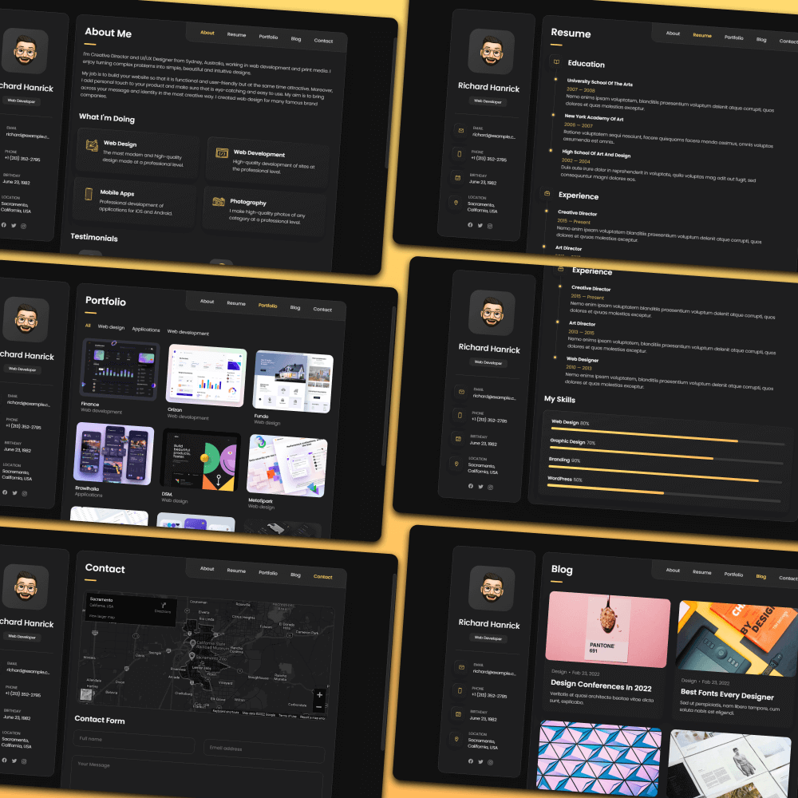
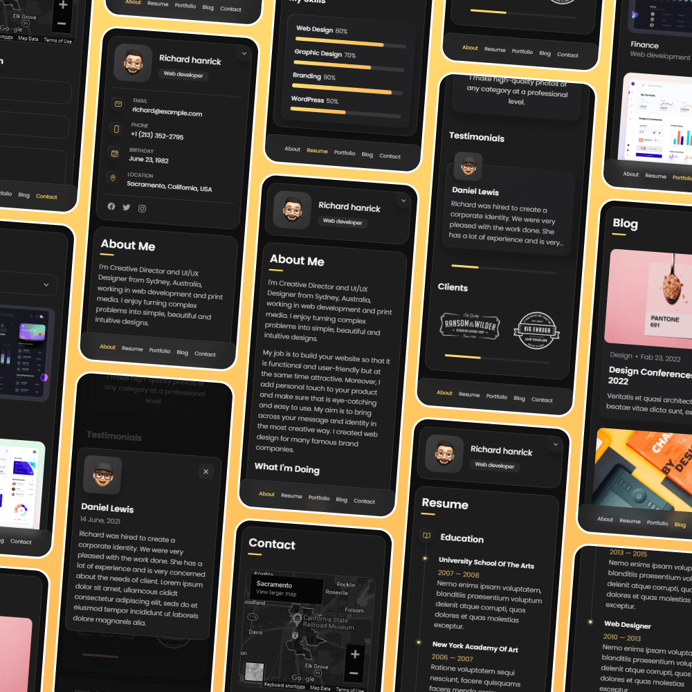

# Aakash Karthikairaja — AI Engineer Portfolio

A responsive portfolio website showcasing AI engineering, RAG architectures, MLOps workflows, and LLM fine-tuning projects. Includes publications, SAEIndia event highlights, and Hyundai EV workshop coverage.

## Demo

## Open locally

Open `index.html` in your browser to view the portfolio.

## Build for deployment

Run `npm run build` to generate the production site in `dist/`. Netlify uses the
same build command and publishes that directory through `netlify.toml`.

## License

MIT
